# FreeDeck Launcher

A clean, fast, customisable home screen for **Amazon Fire TV**. Big app cards, a live greeting / clock / weather
bar, your own wallpapers, a built-in screensaver, and a Home button that opens FreeDeck instead of Amazon's launcher.


> FreeDeck Launcher is made only for Amazon Fire TV and Fire TV Sticks (Fire OS). It is not tested on Android TV or
> Google TV.

---

## Features

### Home screen
- **Top bar**: a greeting that follows the time of day (Good Morning, Afternoon, Evening, Night), the time, the date,
  your city and the current temperature with a weather icon. Each piece can be shown or hidden.
- **Pill navigation** at the top right with four buttons: **Home**, **All Apps**, **Settings** and **Wi-Fi**. The
  selected one is highlighted, and you can reorder the buttons.
- **Favorites row** along the bottom: big app cards with the app's own banner. The page behind them takes a soft glow
  from the colour of the focused app.
- **Location and weather** come from your network (no GPS) and refresh by themselves.

### Favorites
- **Add card (+)**: the last card in the favorites row. Press it to open the *Add to Favorites* picker.
- **Add to Favorites picker**: every installed app as a card, two across. A **+** badge on an app means "not a
  favorite yet" and a **−** badge means "already a favorite". Select a card to add or remove it. The picker stays open so
  you can change several apps in one go, and **Back** closes it.
- **Rearrange favorites**: press and hold an app in the favorites row. The cards start to wiggle. Move the held card
  with **Left / Right**, then press **OK** (or **Back**) to put it down.


| The + card in the favorites row | Add to Favorites picker |
| --- | --- |
| 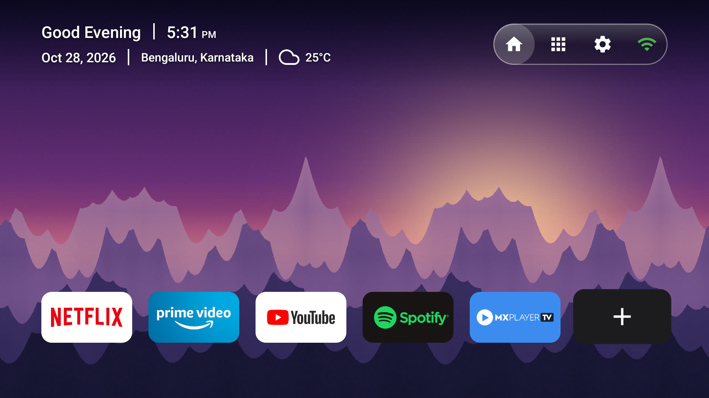 | 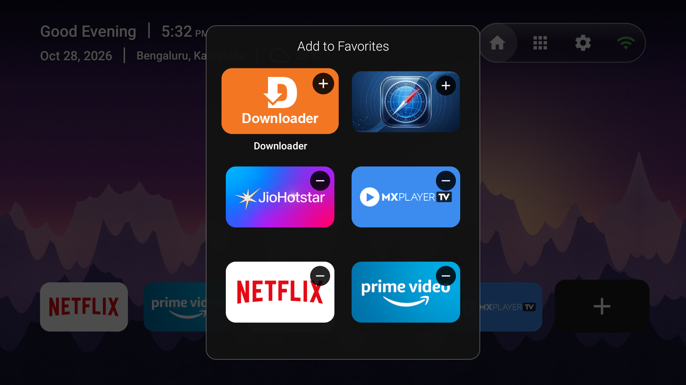 |

| Press and hold to rearrange (cards wiggle) |
| --- |
| 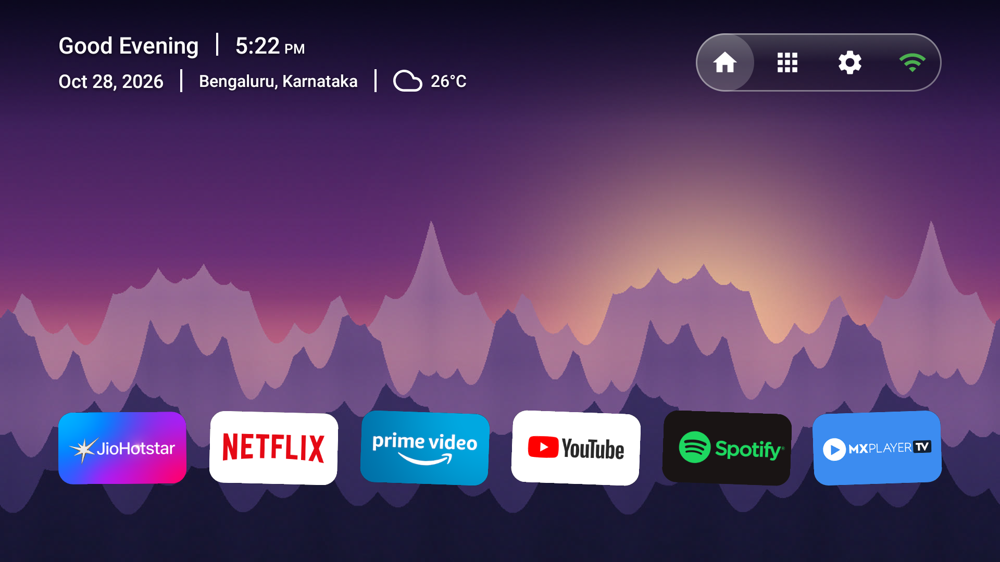 |

### All Apps
- A grid of every installed app, with your **favorites first**.
- **Favorite badge**: an app that is a favorite wears a small **bookmark ribbon with a heart** in its top corner, so you
  can tell at a glance what is on your home screen.
- **Press and hold** an app for its details card: the app's picture, name, **version**, **install date** and package
  name, with an **Add to Favorites** or **Remove from Favorites** button.
- **Layout**: show **5x3, 6x3 or 3x3** apps at a time (columns x rows). More apps scroll in a row at a time.
- Amazon's Silk browser is shown as **Internet** with its own banner.

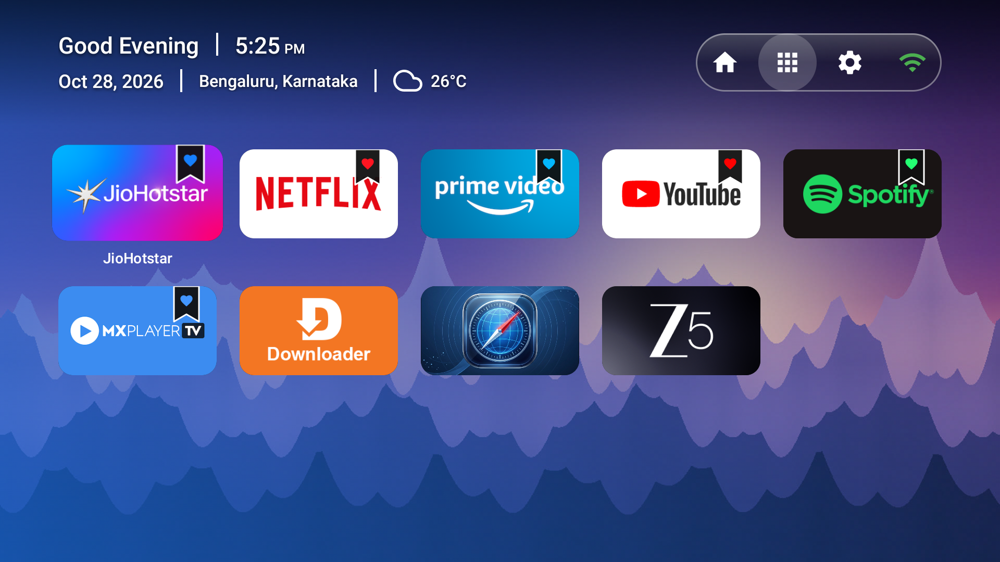

| Press and hold: a favorite | Press and hold: not a favorite yet |
| --- | --- |
| 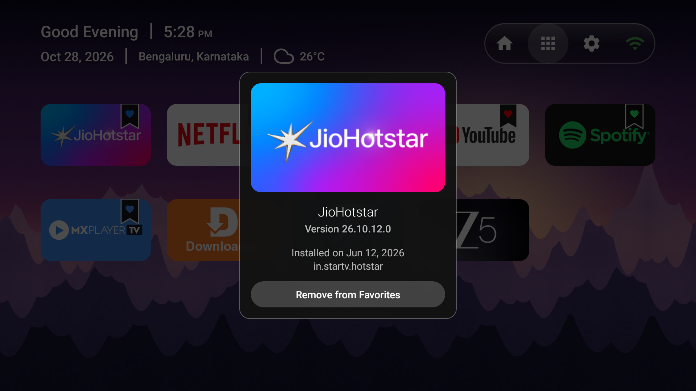 | 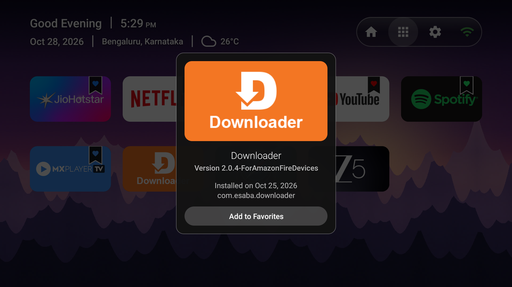 |

### Make FreeDeck your default launcher
- Fire TV has no "default home app" setting, so FreeDeck does what Home on Fire does: when you press **Home**, it
  opens over Amazon's home screen. Turn **Make Default Launcher** off any time to go back to Amazon's.
- On first launch FreeDeck asks *"Allow FreeDeck to be your Default Launcher"* with **Deny** and **Allow**. Deny is
  remembered and the question never comes back.
- Turning it on also switches off Fire TV's own screensaver so only one screensaver runs.
- Needs a one-time permission, see [Install](#install).

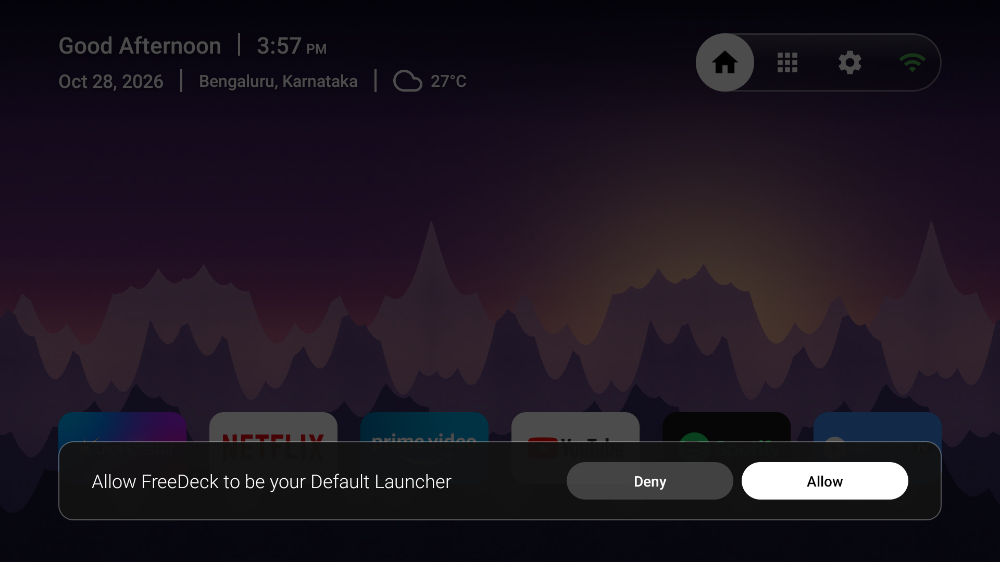

### Screensaver
- Its own screensaver replaces Fire TV's: a full-screen scene with the **greeting, time, date, location and weather**
  in the bottom-left corner.
- **Start after** 30 seconds, 1, 2, 5 or 10 minutes of no use.
- **Live Motion**: the picture slowly scrolls sideways, forever, as if wrapped round a turning cylinder.
- **Screensaver Background**: pick one picture, or choose **Random System** / **Random Custom** to cycle through the
  built-in scenes or your own uploaded pictures.
- **Screensaver Widgets**: choose which of Greeting, Time, Date, Location and Weather appear.
- **Press any key to wake it.** That key press is not passed on, so waking the screen never opens an app by accident.

| Screensaver settings | Screensaver |
| --- | --- |
| 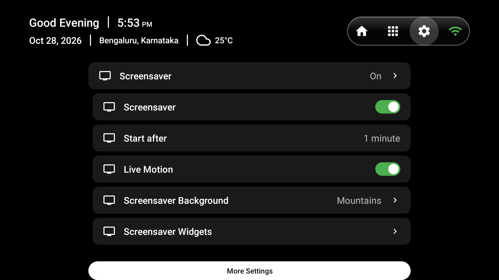 | 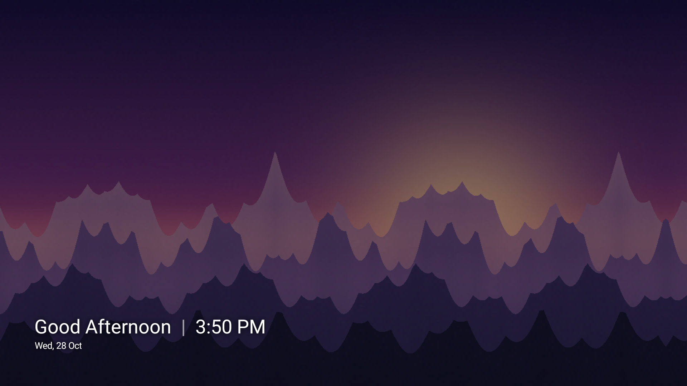 |

### Backgrounds
- **14 built-in backgrounds**: 8 illustrated scenes (Mountains, Night Sky, City, Sunset Sea, Pine Forest, Desert,
  Northern Lights) and 6 colour gradients (Aurora, Sunset, Ocean, Forest, Nebula, Ember), plus **None**.
- **Random System** cycles through the built-in ones; **Random Custom** cycles through your own.
- **Up to 5 custom pictures**: the **+** tile at the end of the list adds one. They are called Custom 1 to Custom 5,
  are shrunk to the screen size, and can be deleted again.
- The same pictures can be used for the launcher and for the screensaver.

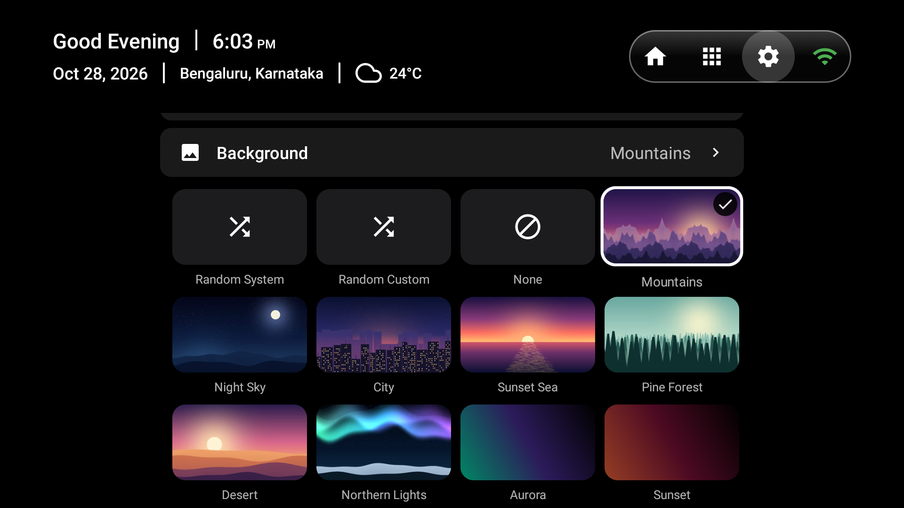

### Upload your own picture from your phone
- Choose the **+** tile and the TV shows a **QR code**. Scan it with a phone on the **same Wi-Fi**, pick a picture, and it
  appears on the TV. No cable, no cloud, no account.
- The link works only on your home network and **expires after 5 minutes**. **Re-Generate Link** makes a new one.
- Pictures up to 10 MB are accepted.

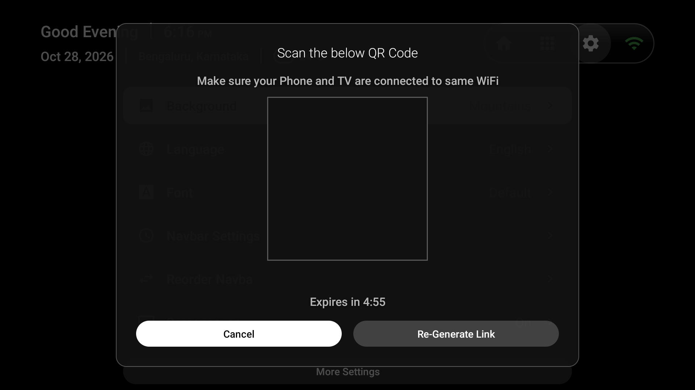

### Navbar
- **Navbar Settings**: choose a **12 or 24 hour** clock, and switch the Greeting, Time, Date, Location and Weather
  on or off.
- **Reorder Navbar**: a live preview of the bar above two lists, **Text** and **Buttons**. Press **OK** to pick one up,
  move it with the arrow keys, press **OK** again to drop it. The real navbar changes as you move things.

| Navbar Settings | Reorder Navbar |
| --- | --- |
| 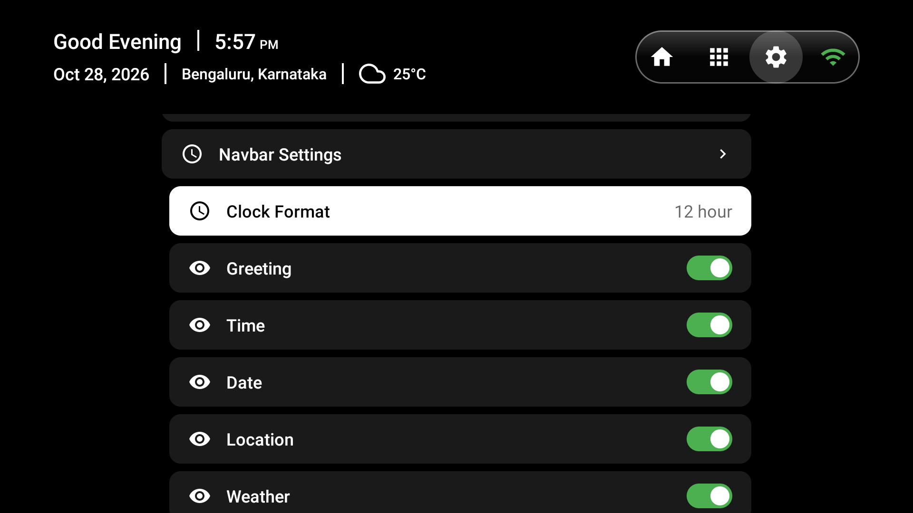 | 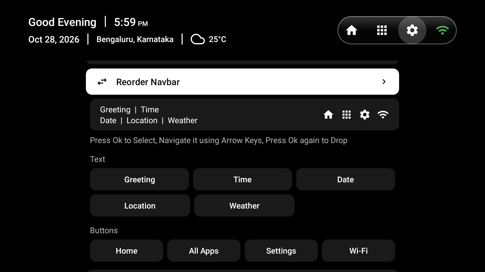 |

### Fonts and colours
- **15 fonts**: Default, Serif, Mono, Poppins, Montserrat, Oswald, Bebas Neue, Orbitron, Righteous, Comfortaa, Fredoka,
  Playfair, Abril Fatface, Lobster, Pacifico and Caveat. Each button is drawn in its own font.
- **Text colour**, separately for **dark mode** and **light mode**, with hue, saturation and brightness sliders, a live
  preview line, **Apply** and **Default**.
- **App Theme**: Dark or Light.

| Fonts | Text colour |
| --- | --- |
| 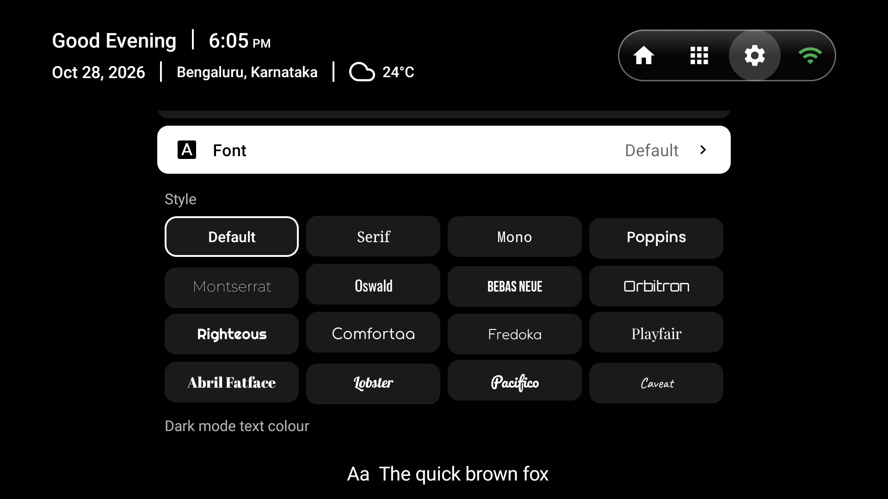 | 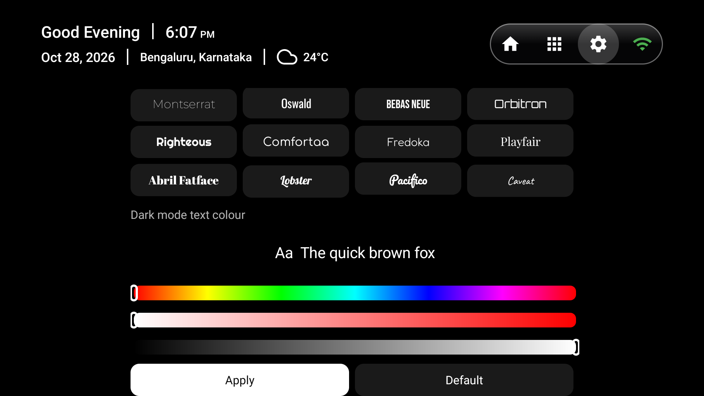 |

### Sounds
- **24 navigation sounds** (or **Off**). Moving onto one plays it, so you can try before you choose.
- A short click plays as focus moves between app cards.

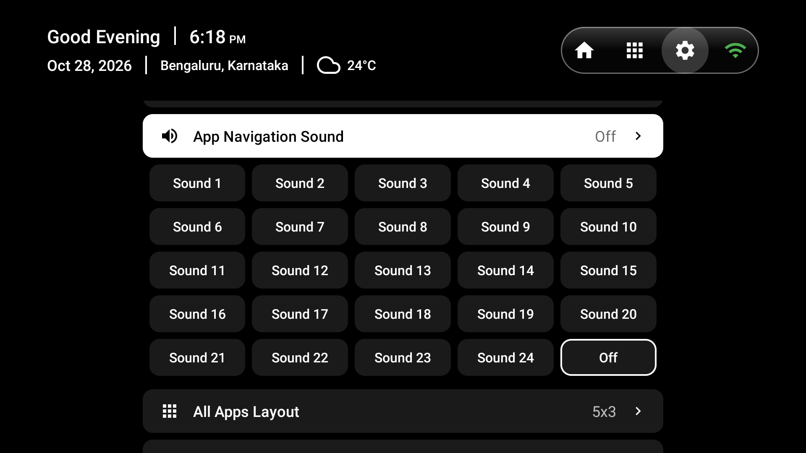

### Wi-Fi at a glance
- A **world map** with a pin at your location, joined to a card showing your **network name**, **Wi-Fi status**,
  **IP address**, **signal strength** (Excellent / Good / Fair / Weak, with the dBm value) and **Wi-Fi band**
  (2.4 GHz or 5 GHz). A **More Settings** button opens Fire TV's own network settings.
- The Wi-Fi icon in the navbar changes colour with the connection: connected, no internet or disconnected.
- A wired (Ethernet) connection is recognised too.

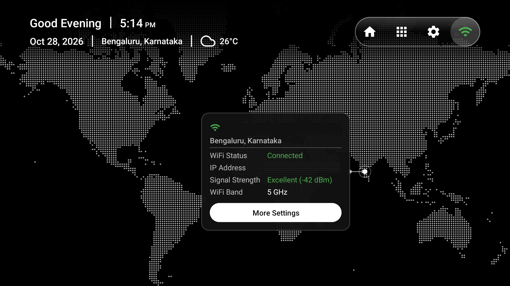

### Settings overview
- One page for everything above: Make Default Launcher, App Navigation Sound, All Apps Layout, App Theme, Background,
  Language, Font, Navbar Settings, Reorder Navbar and Screensaver. Each row shows its current value.
- A **More Settings** button at the bottom opens Fire TV's own full Settings menu.

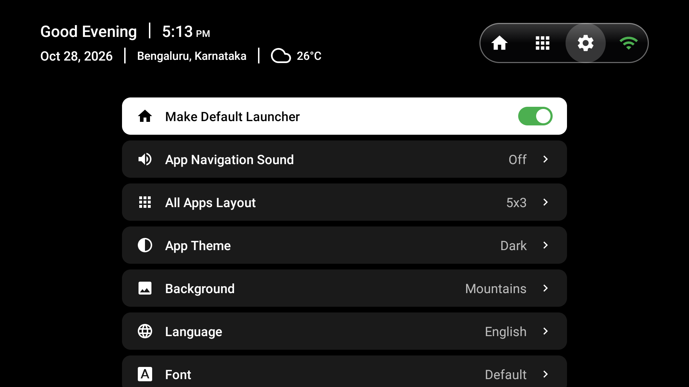

### Languages
13 languages, each shown in its own script: English, Hindi (हिन्दी), Bengali (বাংলা), Marathi (मराठी), Telugu (తెలుగు),
Tamil (தமிழ்), Gujarati (ગુજરાતી), Urdu (اردو), Kannada (ಕನ್ನಡ), Odia (ଓଡ଼ିଆ), Malayalam (മലയാളം), Punjabi (ਪੰਜਾਬੀ) and
Assamese (অসমীয়া). Choosing one rebuilds the screen straight away.

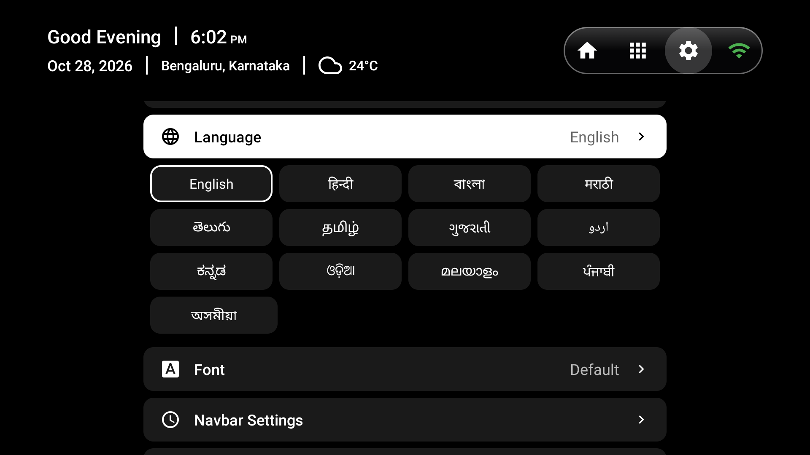

### Light and private
- About 5 MB. No ads, no accounts, no analytics.
- Internet access is used only for the weather and approximate location lookup.
- Your settings, favorites and pictures stay on the TV.

---

## Install

You will install the APK onto the Fire TV from a computer (recommended) or directly on the TV with the Downloader app.

**Download:** every release APK is in the [`apks/`](apks/) folder (for example `apks/FreeDeck-Launcher-v1.0.apk`), with
a `.sha256` checksum next to it. The newest version is listed in [`apks/README.md`](apks/README.md).

### 1. Prepare the Fire TV

1. **Settings → My Fire TV → About**, then click the **device name (or "Fire TV Stick") 7 times** until it says "You are
   now a developer".
2. **Settings → My Fire TV → Developer Options**, then turn on:
   - **ADB debugging**
   - **Install unknown apps** (or **Apps from Unknown Sources**). On newer Fire OS this is per app: allow it for
     *Downloader* if you use that method.
3. Find the TV's IP address: **Settings → My Fire TV → About → Network** (for example `192.168.0.9`).

### 2. Install ADB on your computer

ADB (Android Debug Bridge) is a small command-line tool from Google.

**macOS** (with [Homebrew](https://brew.sh)):
```bash
brew install android-platform-tools
```

**Windows** (PowerShell):
```powershell
winget install Google.PlatformTools
```
or download "SDK Platform-Tools for Windows" from <https://developer.android.com/tools/releases/platform-tools>, unzip
it, and run the commands below from that folder.

**Linux** (Debian / Ubuntu):
```bash
sudo apt install adb
```

Check it works:
```bash
adb version
```

### 3. Connect to the TV

Your computer and the TV must be on the same Wi-Fi.

```bash
adb connect 192.168.0.9:5555      # use your TV's IP
adb devices                       # the TV should be listed as "device"
```

The first time, the TV asks **"Allow USB debugging?"**. Tick *Always allow from this computer* and choose **Allow**.

### 4. Install FreeDeck Launcher

```bash
adb -s 192.168.0.9:5555 install -r FreeDeck-Launcher.apk
```

`-r` replaces an existing install and keeps its data. If you get `INSTALL_FAILED_VERSION_DOWNGRADE`, the TV already
has a newer version; add `-d` to install over it anyway:

```bash
adb -s 192.168.0.9:5555 install -r -d FreeDeck-Launcher.apk
```

### 5. Allow FreeDeck to be your home screen

FreeDeck redirects the Home button with an accessibility service. Fire TV has no screen to turn such a service on,
so FreeDeck turns it on itself, and for that it needs the `WRITE_SECURE_SETTINGS` permission. Android cannot show a
popup for this permission; it has to be granted once. Run this on your computer:

```bash
adb -s 192.168.0.9:5555 shell pm grant com.nison.freedeck android.permission.WRITE_SECURE_SETTINGS
```

Then open FreeDeck and choose **Allow** on *"Allow FreeDeck to be your Default Launcher"* (or turn on **Make Default
Launcher** in Settings). Press **Home**, and FreeDeck opens.

The same permission also lets FreeDeck switch off Fire TV's own screensaver so only one screensaver runs.

> **Reinstalling?** Uninstalling the app removes the permission. Run the `pm grant` command again after a fresh
> install. Updating with `install -r` keeps it.

#### Without a computer

If the permission is missing when you press **Allow**, FreeDeck gives it to itself through the TV's own ADB service.
This needs **ADB debugging** turned on in Developer Options. The TV then shows its standard *"Allow USB debugging?"*
question: choose **Allow** (tick *Always allow* to never be asked again). If FreeDeck cannot do it, it shows the exact
command to run from a computer instead.

> Tested on an Android TV emulator. On a real Fire TV the TV may refuse local connections, in which case use the
> `pm grant` command above.

### Install with the Downloader app (no computer)

1. Install **Downloader** (by AFTVnews) from the Amazon Appstore.
2. Allow it to install unknown apps (step 1 above).
3. Open Downloader and enter the APK link from the FreeDeck website, then install.
4. You will still need the one-time `pm grant` command from step 5 for the Home button feature. Everything else works
   without it.

---

## Useful commands

| What | Command |
| --- | --- |
| Connect | `adb connect <tv-ip>:5555` |
| List devices | `adb devices` |
| Install or update | `adb -s <tv-ip>:5555 install -r FreeDeck-Launcher.apk` |
| Install over a newer version | `adb -s <tv-ip>:5555 install -r -d FreeDeck-Launcher.apk` |
| Grant the permission | `adb -s <tv-ip>:5555 shell pm grant com.nison.freedeck android.permission.WRITE_SECURE_SETTINGS` |
| Check the permission | `adb -s <tv-ip>:5555 shell dumpsys package com.nison.freedeck \| grep WRITE_SECURE_SETTINGS` |
| Open FreeDeck | `adb -s <tv-ip>:5555 shell am start -n com.nison.freedeck/.ui.main.MainActivity` |
| Take a screenshot | `adb -s <tv-ip>:5555 shell screencap -p /sdcard/s.png && adb -s <tv-ip>:5555 pull /sdcard/s.png` |
| Uninstall completely | `adb -s <tv-ip>:5555 uninstall com.nison.freedeck` |
| Disconnect | `adb disconnect <tv-ip>:5555` |

### Turn the Home button feature on manually

If you ever need to switch the service on from the computer instead of from the app:

```bash
adb -s <tv-ip>:5555 shell settings put secure enabled_accessibility_services com.nison.freedeck/com.nison.freedeck.system.HomeRedirectService
adb -s <tv-ip>:5555 shell settings put secure accessibility_enabled 1
```

### Go back to Amazon's home screen

Turn **Make Default Launcher** off in FreeDeck's Settings, or uninstall the app.

---

## Troubleshooting

- **`device offline` or `Operation timed out`**: run `adb disconnect <tv-ip>:5555`, then `adb connect <tv-ip>:5555`.
  If it still fails, turn ADB debugging off and on again in Developer Options, and check the TV's IP has not changed.
- **`unauthorized`**: accept the *"Allow USB debugging?"* question on the TV.
- **`INSTALL_FAILED_VERSION_DOWNGRADE`**: install with `-r -d`.
- **`INSTALL_FAILED_UPDATE_INCOMPATIBLE`**: the installed copy was signed with a different key. Uninstall it first
  (`adb uninstall com.nison.freedeck`), then install again.
- **Pressing Home still opens Amazon's launcher**: check that the permission is granted (see *Check the permission*
  above) and that **Make Default Launcher** is on in Settings.
- **FreeDeck is not in Settings → Accessibility**: Fire TV does not list third-party accessibility services there.
  That is expected; use the `pm grant` command.
- **Wi-Fi name shows "Network Name Hidden"**: allow the location permission when FreeDeck asks. It is used only to
  read the network name, never your location.

---

## Build from source

You need JDK 17 and the Android SDK (API 35). Android Studio installs both.

```bash
git clone https://github.com/2nison6/FreeDeck-Launcher.git
cd FreeDeck-Launcher
./gradlew assembleDebug        # app/build/outputs/apk/debug/app-debug.apk
./gradlew assembleRelease      # app/build/outputs/apk/release/app-release.apk
./gradlew testDebugUnitTest    # unit tests
./gradlew lintRelease          # lint (should report no errors)
./gradlew installDebug         # build and install on the connected device
```

Set `sdk.dir` in `local.properties` if Gradle cannot find the SDK (Android Studio does this for you).

### Release signing

Without a key, `assembleRelease` signs with the debug key so a fresh clone still builds. To make a real release,
create your own key **outside the repository** and never commit it:

```bash
keytool -genkeypair -v -keystore ~/FreeDeck-signing/freedeck-release.jks -alias freedeck \
        -keyalg RSA -keysize 4096 -validity 36500
```

Then create `~/FreeDeck-signing/keystore.properties` (or `keystore.properties` in the project root, which is ignored by git):

```properties
storeFile=/Users/you/FreeDeck-signing/freedeck-release.jks
storePassword=...
keyAlias=freedeck
keyPassword=...
```

Always sign with the same key: Android refuses to update an installed app that was signed with a different one.
Back the keystore up somewhere safe; if you lose it, users have to uninstall before they can install your next version.

### Making a release

1. Bump `versionCode` and `versionName` in `app/build.gradle` (versions start at `1.0`).
2. `./gradlew clean testDebugUnitTest lintRelease assembleRelease`
3. Copy the APK into `apks/` as `FreeDeck-Launcher-vX.Y.apk`, write its checksum, and add a line to `apks/README.md`:
   ```bash
   cp app/build/outputs/apk/release/app-release.apk apks/FreeDeck-Launcher-v1.1.apk
   (cd apks && shasum -a 256 FreeDeck-Launcher-v1.1.apk > FreeDeck-Launcher-v1.1.apk.sha256)
   ```
4. Commit, tag (`git tag v1.1 && git push --tags`) and attach the APK to a GitHub Release.

### Publishing the APK on a website

- Link straight to the file in a GitHub Release (or to `apks/`), or host the APK yourself as a plain download link. A short
  link is easy to type into Downloader on the TV.
- Publish the SHA-256 next to the download so people can check the file:
  ```bash
  shasum -a 256 -c FreeDeck-Launcher-v1.0.apk.sha256
  ```

### Project layout

```
app/src/main/java/com/nison/freedeck/
  data/        apps, settings, weather, location, phone upload server
  system/      default launcher, Home-button service, Fire TV settings, ADB self-grant, network status
  ui/          home, apps grid, settings, screensaver, dialogs
app/src/main/res/   layouts, drawables, sounds, fonts, translations
tools/              scripts that generate scenes, the world map and the sounds
```

---

## Permissions

| Permission | Why |
| --- | --- |
| `INTERNET` | Weather and approximate location lookup |
| `ACCESS_NETWORK_STATE`, `ACCESS_WIFI_STATE` | Wi-Fi status and signal strength |
| `ACCESS_FINE_LOCATION` | Android only reveals the Wi-Fi network name with this; location itself is never read |
| `WRITE_SECURE_SETTINGS` | Lets FreeDeck switch on its Home-button service and turn off Fire TV's screensaver (granted once with adb) |

---

## Credits

FreeDeck Launcher is an independent project and is not affiliated with Amazon. Fire TV is a trademark of
Amazon.com, Inc. The Home-button approach is the same one used by the open-source *Home on Fire* app.
